# Mini Pupper 4 — User Guide

The MP4 is a small four-legged robot with a face, a voice, and a phone app that
does everything. It can walk, trot, pose, jump, show emotions, play music, hold a
conversation, and run skills; small programs that make it do something new.

This guide is divided into two halves:

- **Everyday use** — sections 1–9: powering on, connecting your phone, driving,
  skills, the Store, chat and voice, and settings.
- **Development** — sections 10–11: flashing firmware, provisioning, and
  building/publishing skills with the `mpx` CLI.

> New robot? Start with [Quick start](#2-quick-start).

---

## Contents

1. [Meet the robot](#1-meet-the-robot)
2. [Quick start](#2-quick-start)
3. [Power and first boot](#3-power-and-first-boot)
4. [Connect your phone](#4-connect-your-phone)
5. [Driving the robot](#5-driving-the-robot)
6. [Skills](#6-skills)
7. [The Skill Store](#7-the-skill-store)
8. [Chat, voice and AI](#8-chat-voice-and-ai)
9. [Settings](#9-settings)
10. [Firmware and flashing (developers)](#10-firmware-and-flashing-developers)
11. [Building and publishing skills (developers)](#11-building-and-publishing-skills-developers)
12. [Troubleshooting](#12-troubleshooting)
13. [Safety, care and privacy](#13-safety-care-and-privacy)
14. [Defaults and limits](#14-defaults-and-limits)
15. [Glossary](#15-glossary)

---

## 1. Meet the robot

### What is on it

<p align="center">
  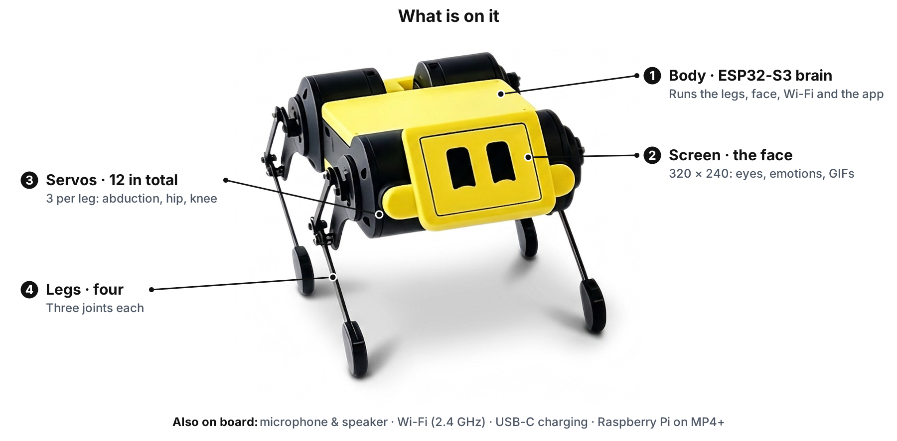
</p>

The numbers match the picture.

| # | Part | What it does |
|:---:|---|---|
| 1 | Body (ESP32-S3) | The brain. Runs the legs, the face, sound, Wi-Fi and the phone app. See [How it is put together](#how-it-is-put-together). |
| 2 | 320 × 240 screen | The face. Shows animated eyes, emotions, GIFs and drawings. |
| 3 | 12 servos | Three per leg: abduction (sideways), hip (forward/back) and knee. |
| 4 | Four legs | Walk, trot, pose and jump. |
| | Microphone and speaker | Wake word, voice chat, music. |
| | Wi-Fi (2.4 GHz) | Serves the phone app; joins your network for the Store and AI. |
| | USB-C port | Charging: the light is red while charging and green when full. |
| | USB port | Firmware flashing and serial logs. |
| | Raspberry Pi (MP4+ only) | ROS 2 / full reinforcement-learning link. |

### How it is put together

The ESP32-S3 inside the robot runs the control loop, the screen, audio, Wi-Fi,
the HTTP server, the on-device agent and the skill sandboxes. There is no app to
download: the robot **serves the phone app itself** at `http://<robot-ip>/`, and
the phone is only a screen and a controller.

There are currently two kinds of skills run on it:

- **Move skills** run on the robot in a WASM sandbox and drive the legs, screen,
  music or files.
- **Web skills** are browser automations that run outside the robot in the AWA
  worker (a locked-down Chromium); the result comes back to the robot's agent.

The on-device agent is called **Pupper**. It answers text chat, can run skills,
and is the brain behind voice turns.

### What it can do

| Thing | Where |
|---|---|
| Walk, trot, turn, strafe, body height and roll | Home |
| Poses, jump, stretches, built-in moves | Home / All moves |
| Emotions and GIF animations | Display, or by asking Pupper |
| Two-way chat | Chat |
| Hands-free voice | Wake word or the Chat microphone |
| Install moves and web skills | Skills / Store / Files |
| Play music | Settings › AI & Voice, or by voice |
| Calibrate legs, flip the screen, change brightness | Settings |

---

## 2. Quick start

From the box to walking in four steps. Stuck? Each step links to the details.

### 1. Charge and turn on

Plug in **USB-C**: the light is **red** while charging and **green** when full.
Then **press and hold** the power button until the green light comes on, and
wait until the robot stands up.

<p align="center">
  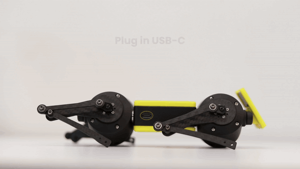
  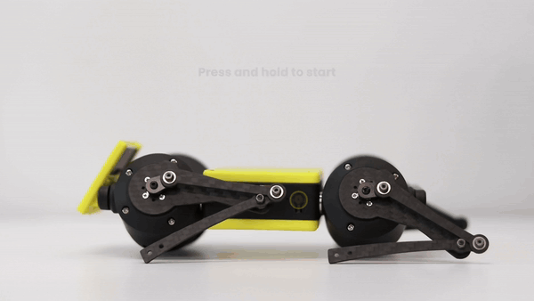
</p>

### 2. Join the robot's Wi-Fi

The robot's screen shows its Wi-Fi name, `MP4-XXXXXX`. Join it on your phone in
**Settings › Wi-Fi**. There is no password.

<p align="center">
  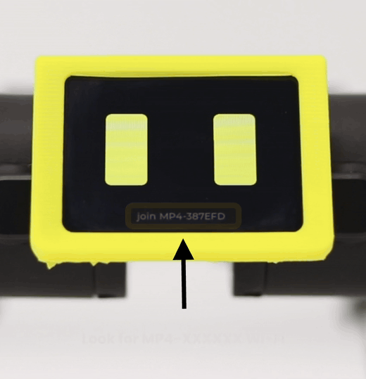
  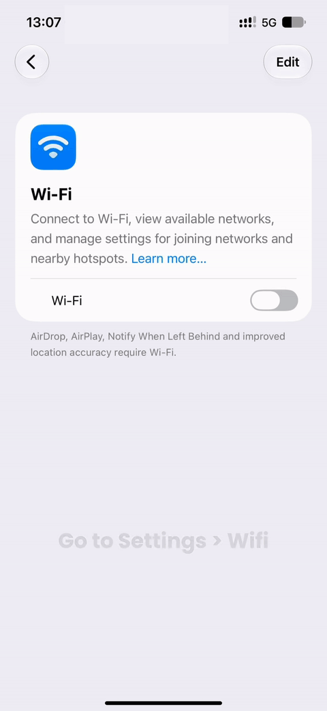
</p>

### 3. Connect the robot to your Wi-Fi

**Slide to unlock** and pick your Wi-Fi, then enter its password and tap **Join**.
(If no page opens, go to **192.168.2.1** in your browser first.)
The robot's screen then shows its new **IP address**.

<p align="center">
  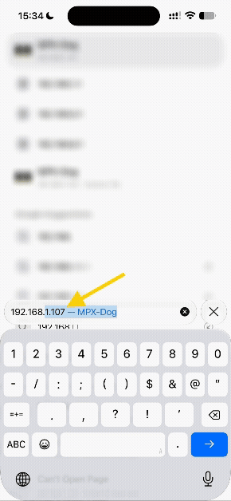
  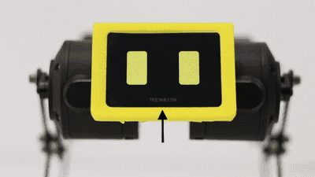
</p>

More help: [Connect your phone](#4-connect-your-phone).

### 4. Open the controller and drive

Put your phone back on **your** Wi-Fi, open the IP address shown on the robot,
and slide to unlock. Then:

**L1** on → **R1** to switch to Trot → **MOVE** stick to walk → **POSE** stick to turn. Let go to stop.

<p align="center">
  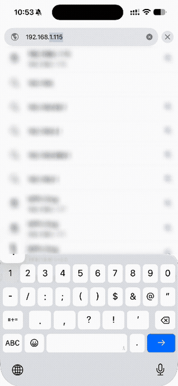
  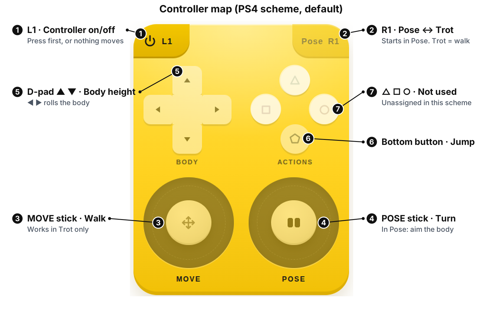
</p>

The controller always starts in **Pose**, and the MOVE stick only works in
**Trot**. More: [Driving the robot](#5-driving-the-robot).

> [!WARNING]
> Turn the controller off (**L1**) before picking the robot up, and lift it by
> the body, never a leg. Use the charger that came with the robot. More in
> [Safety](#13-safety-care-and-privacy).

---

## 3. Power and first boot

Turning on is covered in [Quick start](#2-quick-start). Once the robot is on, its
face tells you what the network is doing:

| Screen | Meaning |
|---|---|
| Two eyes | Ready. The robot is on its hotspot, and may also be on your Wi-Fi. |
| `join <network>` | Trying to join a saved network. |
| `no network` | No saved network and no connection. The hotspot still works. |
| An IP address, e.g. `192.168.1.105` | Connected to your network. This is the address to open in the browser. |
| `ZZ` | Asleep/idle. The robot is still connected; a move or a control wakes it. |

The robot starts its own hotspot **every time it boots**, even when it is also on
your Wi-Fi. If you move to a new network, you can always join the hotspot and set
it up again.

> **Screen stays dark?** Hold the power button until the green light comes on,
> and check the battery. Still dark? See [Troubleshooting](#12-troubleshooting).

---

## 4. Connect your phone

The app is a web app (PWA) that the robot serves itself: there is nothing to
install from an app store, and driving works without internet. The steps are in
[Quick start](#2-quick-start), steps 2–4. This section covers the details.

### 4.1 The robot's hotspot

- **Name:** `MP4-XXXXXX`. The six characters come from the robot's MAC address,
  so every robot has its own name. It is **open** (no password).
- **Address:** on its hotspot the robot is always at **http://192.168.2.1/**.
  Joining usually opens the app by itself as a "sign in to network" page.
- **Welcome screen:** on a fresh robot, Wi-Fi setup appears after you slide to
  unlock. After a successful connection it is skipped for 24 hours.
- **No internet:** the hotspot is fine for driving, but the Store, AI and voice
  need the robot on your Wi-Fi.

### 4.2 Joining your Wi-Fi


- **2.4 GHz only.** A 5 GHz-only network will not appear in the list.
- **Enterprise networks** show an extra identity field.
- **While joining**, the robot restarts its network (not a reboot). The page may
  stop answering for a few seconds; if the app asks, rejoin the hotspot.
- **When it has joined**, the app and the robot's screen both show its new IP
  address. Put your phone on the same Wi-Fi and open that address, for example
  `http://192.168.1.105/`. Later visits reconnect automatically; if not, tap the
  Wi-Fi pill at the top of Home.

> **The IP can change.** Most routers hand out a new address after a reboot. The
> screen always shows the current one. For a fixed address, reserve one for the
> robot in your router's DHCP settings.

<br clear="right">

### 4.3 Change networks later

- **Home:** tap the Wi-Fi pill in the top-left (or pull it down) to open the
  network picker.
- **Settings › ESP Wi-Fi:** see the current network and IP, **Disconnect** or
  **Forget network** (the robot then falls back to its hotspot), join a nearby
  network, or type the name of a hidden network.
- **Settings › ESP hotspot:** rename the robot's hotspot and set a password (at
  least 8 characters, or empty for open). Saving restarts the hotspot; rejoin it
  with the new name and password.

> **Security:** the default hotspot is open, so anyone nearby can join it. Set a
> hotspot password in **Settings › ESP hotspot** if that matters where you use
> the robot.

### 4.4 Install it like an app (limited)

You can add the app to your phone's home screen with the browser's **Add to Home
Screen** / **Install app** action. It is still served by the robot, so it only
works while the phone can reach the robot.

> **Note:** the app is served over HTTP, which browsers treat as an _insecure
> context_, so it may not install as a full app unless the address is allowed in
> the browser's settings (for example in `chrome://flags`).

---

## 5. Driving the robot

### 5.1 The Home screen

<p align="center">
  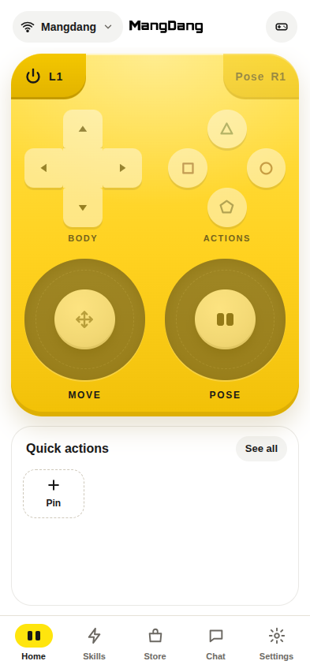
</p>

| Area | What it does |
|---|---|
| Wi-Fi pill (top left) | Shows the network the robot is on. Tap or pull down to change it. |
| Gamepad icon (top right) | Full-screen landscape controller (phone only). |
| Controller | L1/R1, BODY d-pad, ACTIONS buttons, MOVE and POSE sticks. See [5.2](#52-ps4-scheme-default) and [5.3](#53-haris-scheme-alternative). |
| Quick actions | Moves you pinned. **See all** opens the full list. |
| Bottom tabs | Home, Skills, Store, Chat, Settings. |

### 5.2 PS4 scheme (default)

The default on a new robot; it behaves like a gamepad. The
[controller map](#4-open-the-controller-and-drive) in Quick start shows where each
button is.

| Control | Action |
|---|---|
| **L1** (left shoulder) | Power the controller on/off. Off disables all controls. |
| **R1** (right shoulder) | Switch between **Pose** and **Trot**. |
| **D-pad up / down** | Raise / lower the body. |
| **D-pad left / right** | Roll the body left / right. |
| **Left stick** (MOVE) | Walk forward/back and strafe, in Trot only. |
| **Right stick** (POSE) | Turn left/right in Trot; aim yaw/pitch in Pose. |
| **Blue pentagon** (bottom face button) | Jump. |
| Triangle / square / circle | Unassigned in this scheme. |
| Arrow keys / WASD (desktop browser) | Walk. |

The controller always starts in **Pose**: press **R1** for Trot before using the
left stick. The label above the right stick shows the current mode (`Pose R1` or
`Trot R1`). Trot is the walking gait; Pose holds the feet and lets you lean, aim
and pose.

### 5.3 Haris scheme (alternative)

Choose this in **Settings › Control scheme** if you prefer direct turning and
assignable face buttons.

| Control | Action |
|---|---|
| **Power icon** (top of the controller) | Power the controller on/off. |
| **L1 / R1** | Turn left / right while held. |
| **D-pad up / down** | Raise / lower the body. |
| **D-pad left / right** | Roll the body left / right. |
| **Left stick** | Move. |
| **Right stick** | Look around; while moving, it turns. |
| **Four face buttons** | Assignable actions. Defaults: Jump, Stretch, Twerk, Situp. |
| **Pencil icon** | Edit which action each face button runs. |

The controller keeps the last scheme you selected. Any custom button assignments
are stored in the app, not on the robot.

### 5.4 Running moves

Moves are listed in **All moves** (**See all** on Home):

<p align="center">
  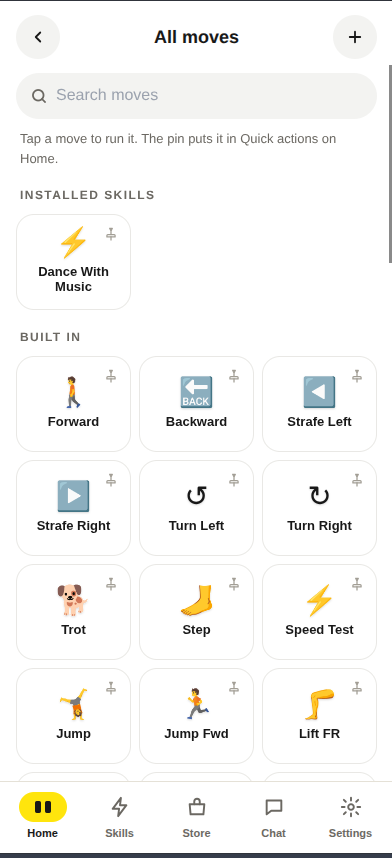
</p>

- **Installed skills** appear first (for example, *Dance With Music*).
- **Built in** moves include Forward, Backward, Strafe Left/Right, Turn
  Left/Right, Trot, Step, Speed Test, Jump, Jump Fwd and single-leg lifts.
- Tap a move to run it; tap the **pin** icon to add it to **Quick actions**; tap
  **+** to create a custom action; use the search box when the list gets long.

A move takes over the robot while it runs. Wake word, voice and music are
stopped, and a second skill is refused rather than queued: one program owns the
legs at a time.

### 5.5 First driving tips

- Start in **Trot** on a flat floor, and move the stick gently. The robot speeds
  up and slows down smoothly rather than snapping to a speed.
- If it bumps something, release the stick. It will stop.
- If a leg looks crooked or the robot walks in an arc, see
  [Calibration](#95-calibration). Do not force a joint by hand.

---

## 6. Skills

A skill is a small program that adds a behaviour: a dance, a walk, a screen
drawing, a browser task. Skills are managed on the **Skills** tab and in
**Files**.

<p align="center">
  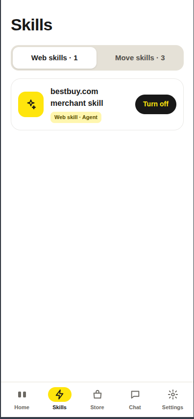
</p>

### 6.1 Move skills

<p align="center">
  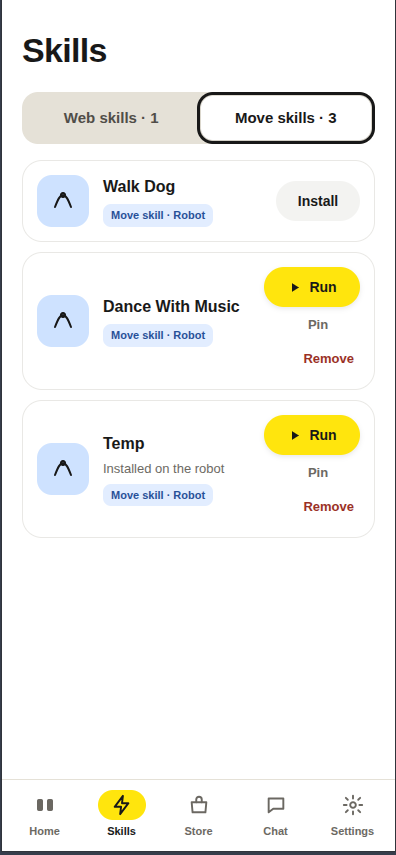
</p>

| Button | What it does |
|---|---|
| **Install** | Downloads and installs the skill on the robot. |
| **Run** | Runs it now. |
| **Pin** | Adds it to Quick actions on Home. |
| **Remove** | Deletes it from the robot. |

A move skill may be:

- **Encrypted** (`.mpxe`) when it came from the Store; the robot decrypts it
  before running.
- **Plain WASM** (`.wasm`) when it was built locally or sideloaded. This is the
  developer format.

Both run in the same WASM sandbox with the same host API. Only one skill runs at
a time, and a running skill holds the robot until it finishes.

### 6.2 Web skills

Web skills are automations that run in a browser outside the robot — for
example, a merchant skill that searches a shop and returns a result. They are
listed on the **Web skills** tab with a toggle:

| Control | What it does |
|---|---|
| **Turn off / Turn on** | Enables or disables the skill for the agent. |
| **Web skill · Agent** badge | The skill is agent-facing; it is invoked by the Pupper agent. |

Web skills need the robot to have internet access. They do not run in voice
turns; see [What voice can do](#83-what-voice-can-and-cannot-do).

### 6.3 Files on the robot

<p align="center">
  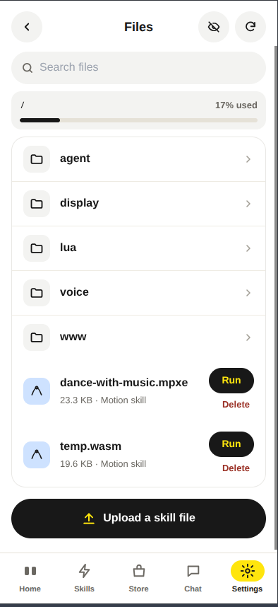
</p>

**Settings › Files on the robot** is a browser for the robot's LittleFS storage.
It shows the folders the robot uses (`agent`, `display`, `lua`, `voice`, `www`),
the space used, and every uploaded skill file. From here you can:

- **Run** a `.wasm` or `.mpxe` file.
- **Delete** a file.
- **Upload a skill file** from the phone.
- Toggle hidden files.

The Files page is the most reliable way to check a skill you installed is on the device.

### 6.4 Custom actions

**All moves › +** creates a custom action. Give it a name and a move or skill,
then pin it to Quick actions. Custom actions are stored in the browser; the
underlying move or skill still has to exist on the robot.

For now a custom action works as a shortcut to a move skill. Running Lua scripts
from custom actions is planned.

---

## 7. The Skill Store

<p align="center">
  
</p>

The Store is where new move and web skills come from. It needs the **robot** to
have internet access — connect it to your Wi-Fi and open the app through the
robot's LAN IP, not through the hotspot.

| Part | What it does |
|---|---|
| Currency selector | Displays prices in your currency. |
| Search | Finds skills by name. |
| **Web skills / Move skills** | Switches the catalogue. |
| Categories | Store, Search, Media. |
| Featured | MangDang's picks for the week. |
| Most popular | Ranked list. |
| **Get** | Free skill; installs it. |
| **A price** | Opens checkout in your browser. |
| **Open** | You already own it. |

<p align="center">
  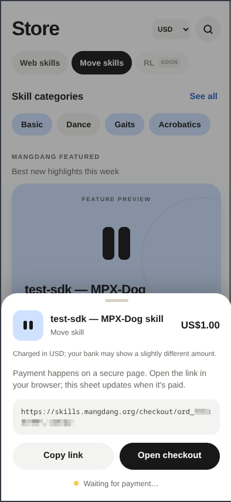
</p>

A paid skill opens the gateway's secure checkout in a browser. After payment,
the app polls the order and installs the skill on the robot. Keep the app open
while the order is pending.

Move skills show a **3D preview** before purchase:

<p align="center">
  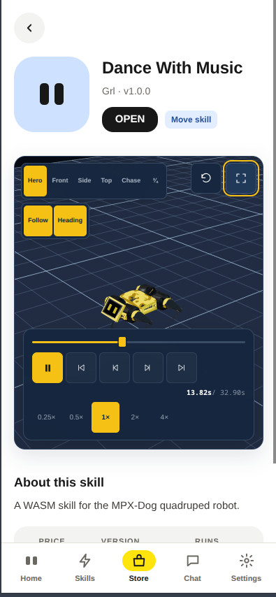
</p>

The preview is a MuJoCo simulation, so poses can differ slightly from the real
robot.

> **Store empty or "offline"?** The robot cannot reach the internet. Reconnect
> it to your Wi-Fi (the screen should show a LAN IP), then reopen the Store.

The **RL** category is marked *soon*; it is not available yet.

---

## 8. Chat, voice and AI

The **Chat** tab is how you talk to Pupper, the robot's on-device agent.

<p align="center">
  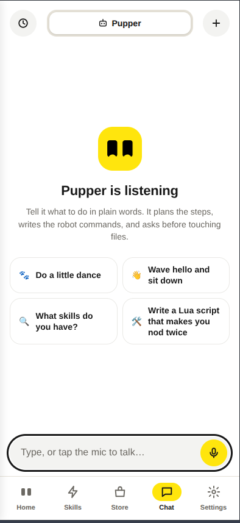
</p>

### 8.1 Text chat

Type a request and send it. Pupper can answer questions, run a move or skill,
write and run short Lua scripts, show an emotion, draw on the screen, play music,
or change a setting. While it works, the message shows the steps it took; some
actions ask for confirmation before doing anything destructive.

- **Pupper** is the local agent running on the robot.
- A conversation is tied to a brain once it has messages; start a new
  conversation with **+** to switch.
- History is kept on the robot and shown in the sidebar, with badges for voice
  and text turns.
- The **Cloud** brain is not available in this build; Pupper handles chat.

### 8.2 Voice

Tap the **microphone** in the Chat tab, or say **"Hi ESP"**. The voice panel
shows what is happening:

| Status | Meaning |
|---|---|
| **Listening — speak naturally** | The microphone is open. |
| **Pupper is thinking** | The turn is being processed. |
| **Speaking — you can interrupt** | The answer is playing; start talking to interrupt. |
| **Ready for a follow-up** | You can continue without saying the wake word again. |

Use **Start talking**, **Speak again**, **Interrupt & speak**, and **End voice
chat** to control the session. You can also end a session by saying the equivalent of
"goodbye" or "enough".

<p align="center">
  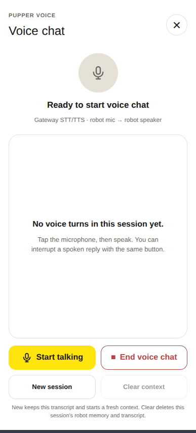
</p>

Voice needs internet: speech recognition and speech synthesis run on the MangDang
gateway, and the robot's agent answers the turn. The gateway pairs with the
robot on first use; if it says **Not paired**, use **Pair with MangDang now** in
**Settings › AI & Voice**.

### 8.3 What voice can and cannot do

A voice turn is kept short so it can answer quickly. It can:

- move the robot (walk, pose, stop),
- show an emotion or draw on the screen,
- play or stop music,
- change simple robot settings.

It cannot use web skills, Lua scripts, or arbitrary WASM skills in a voice turn. This is to improve the latency between user speech and response.
Those tools are available in **text** chat, where there is time for a longer
task. If you need a skill that browses a shop or runs a long sequence, type it.

### 8.4 AI modes

Choose the brain in **Settings › AI & Voice**:

| Mode | Chat | Voice | Notes |
|---|---|---|---|
| **MangDang AI** (default) | MangDang cloud | MangDang cloud | Nothing to configure. Needs internet. |
| **My own AI account** | Your API key | Still MangDang's AI | The key is stored on the robot. Chat with Pupper uses your provider; voice answers still come from MangDang for now. |
| **AI off** | Off | Off | The microphone is never used for AI. Walking, the controller and the Store still work. |

**My own AI account** supports Anthropic, OpenAI, DeepSeek and custom
OpenAI-compatible or Anthropic-compatible endpoints. Fill in the provider, model,
base URL and API key. The saved key is masked in the app; it is not shown again
after saving.

Changing the mode may apply immediately or restart the robot (about 20 seconds),
depending on what changed.

### 8.5 Music

Music is part of the voice/AI settings, but it also works without a chat:

- **Settings › AI & Voice › Music** lets you pick a genre or paste a stream URL,
  then **Play** or **Stop**.
- By voice: *"Hi ESP, play some jazz."*
- Music stops when a skill takes over the robot, when you start a voice turn, or
  when you stop it.

---

## 9. Settings

<p align="center">
  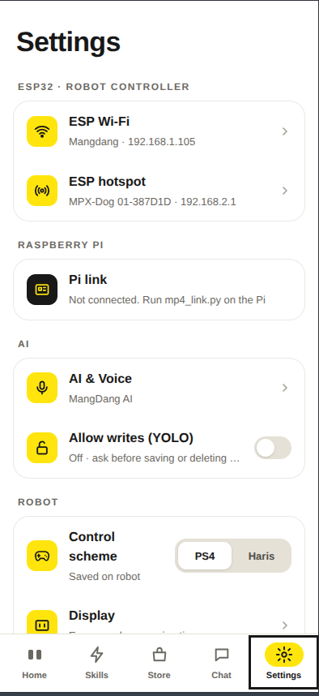
</p>

Settings is split into sections. The most useful rows:

| Section | Row | What it does |
|---|---|---|
| ESP32 | **ESP Wi-Fi** | Current network and IP; join, disconnect, forget, hidden network. |
| ESP32 | **ESP hotspot** | Rename the robot's hotspot and set a password. |
| Raspberry Pi | **Pi link** | Optional Pi connection; shows whether the Pi is reachable. |
| Raspberry Pi | **Shut down / Restart** | Stops the Pi safely. Only when a Pi is connected. |
| AI | **AI & Voice** | AI mode, keys, voice pairing, microphone/speaker and music. |
| AI | **Allow writes (YOLO)** | On: the agent saves and deletes files without asking. Off: it asks first. Leave it off unless you are testing. |
| Robot | **Control scheme** | PS4 or Haris; saved on the robot. |
| Robot | **Display** | GIFs, brightness, 180° flip. |
| Robot | **Calibration** | Per-joint offsets with a 3D leg view. |
| Robot | **MangDang Servo Studio** | Servo gains on the driver boards. Advanced. |
| Robot | **Rest when idle** | Lie down and switch the servos off after 2, 5, 10 or 30 minutes, or never. **Rest now** / **Stand up now**. |
| Advanced | **Files on the robot** | Browse, upload and run skill files. |

### 9.1 Network

**ESP Wi-Fi** and **ESP hotspot** are covered in
[Change networks later](#43-change-networks-later). **Networks nearby** is a live
scan: tap a network, enter the password, join. The robot supports 2.4 GHz Wi-Fi
only.

### 9.2 AI and voice

See [Chat, voice and AI](#8-chat-voice-and-ai). The voice section also shows
whether the gateway is paired, whether the microphone and speaker are ready, and
a volume slider.

### 9.3 Robot behaviour

- **Control scheme** switches between PS4 and Haris. The choice is saved on the
  robot, so it follows you to another phone.
- **Rest when idle** puts the body down and switches the servos off after the
  chosen idle time. Any move, the controller, or **Stand up now** wakes it.
  Resting is good for the servos and the battery.
- **Allow writes (YOLO)** controls whether the agent may save or delete files
  without a confirmation card. Keep it off for normal use.

### 9.4 Display

<p align="center">
  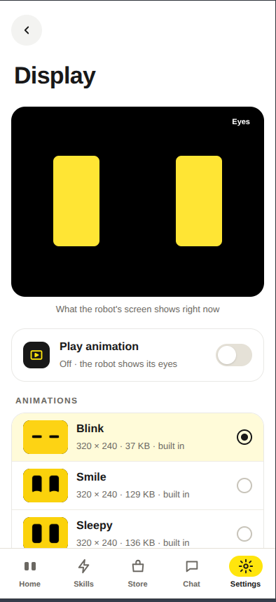
</p>

- **Play animation** pauses the eyes and plays the selected GIF.
- **Animations** lists built-in and uploaded GIFs with their size. Built-in
  animations cannot be deleted; uploaded ones can.
- **Add a GIF** accepts a GIF up to **320 × 240** and under **600 KB**. Larger
  files are rejected.
- **When it ends**: **Loop it** keeps the animation up; **Play once, then eyes**
  returns the face when it finishes.
- **Brightness**: 5–100%, in 5% steps.
- **Turned 180°**: flips the picture if the screen was mounted upside down.

### 9.5 Calibration

<p align="center">
  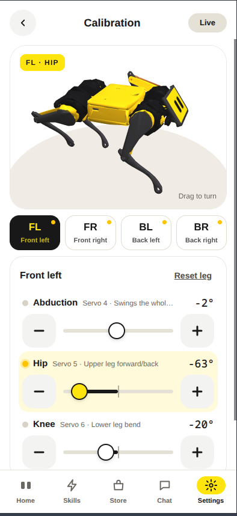
</p>

Calibration adjusts the **zero offset** of each servo. Use it when a leg is
visibly crooked in the neutral pose, or when the robot walks in a curve with all
four feet on the ground.

1. Pick a leg: **FL**, **FR**, **BL** or **BR**.
2. Pick a joint: **Abduction**, **Hip** or **Knee**.
3. Use **−** / **+** to move the joint in one-degree steps (range ±90°). The 3D
   view follows the selected joint.
4. Changes are sent to the robot as you make them and saved live.
5. **Reset leg** returns that leg to zero; **Reset all offsets** clears every
   adjustment.

Do not use calibration to compensate for a mechanically bent leg, a loose horn
or a broken servo. Fix the hardware first; offsets are meant for small trim only.

### 9.6 MangDang Servo Studio

This exposes the servo driver gains. It is for advanced tuning: the defaults are
correct for the stock robot, and changing them can make the legs buzz, overheat
or oscillate. Leave it alone unless you know why you are changing it.

### 9.7 Advanced

- **Files on the robot** is described in [Files](#63-files-on-the-robot).

---

## 10. Firmware and flashing (developers)

You do **not** need this section to use the robot. Firmware updates are currently done
over USB; the Store updates skills, not firmware.

In a future update, we will implement OTA updates.

### 10.1 What you need

- The robot and a USB data cable (not a charge-only cable).
- **ESP-IDF v5.5.4** and its toolchain, or the project's dev container.
- Node.js/npm for the phone app build (the dev container has it). Without Node,
  build with `-DMPX_BUILD_PWA=OFF` and the existing embedded web app is kept.
- On Linux, permission to the serial port (`dialout` group) or run as root in
  the container.

The dev container is the recommended path, but you are free to use the VScode extension or
installing from EspressIf's website directly.


### 10.2 Build

```bash
idf.py set-target esp32s3     # first checkout only | can be skipped as auto-detect should be esp32s3
idf.py build
```

A fresh checkout has no `sdkconfig`, so the target must be given once. The
build produces:

| File | Purpose |
|---|---|
| `build/MPX-Dog.bin` | The application image (~4.9 MB). |
| `build/bootloader/bootloader.bin` | Second-stage bootloader. |
| `build/partition_table/partition-table.bin` | Partition layout. |
| `build/srmodels/srmodels.bin` | Speech models. |
| `build/system.bin` | Read-only system files. |
| `build/MPX-Dog.elf` | Symbols for decoding crashes. |

The phone app under `pwa-claw/` is built and embedded automatically when its
sources changed. Useful knobs:

```bash
MPX_FORCE_PWA=1 idf.py build      # rebuild the web app anyway
MPX_SKIP_PWA=1 idf.py build       # embed pwa-claw/www as-is
idf.py -DMPX_BUILD_PWA=OFF build  # no npm at all
```

Do not edit `pwa-claw/www/` and expect it to reach the robot without a rebuild:
the firmware embeds the generated assets at build time.

### 10.3 Flash

Find the port:

```bash
# Linux
ls /dev/ttyUSB* /dev/ttyACM*
# macOS
ls /dev/cu.usbserial-* /dev/tty.usbserial-*
# Windows: Device Manager → Ports (COM & LPT)
```

Then:

```bash
idf.py -p /dev/ttyUSB0 flash
```

`flash` writes the bootloader, partition table, app and the extra images.
`app-flash` writes only the application and is faster for a normal code change.
If the port is busy, close any monitor or serial program first.

If flashing cannot connect, put the board in download mode: hold **BOOT**, tap
**RESET**, release **BOOT**, then retry.

> **WARNING**: Some USB cables and some computer ports could power the servos upon connection.
> This can be dangerous to the computer, as back-current can fry your USB port or even your motherboard.
> You can just reconnect the cable to stop this behavior.

### 10.4 Monitor and verify

```bash
idf.py -p /dev/ttyUSB0 monitor
```

Exit the monitor with `Ctrl+]`. On boot you should see the firmware start, the
display and audio initialise, the Wi-Fi AP start, and a line with the app URL.
`main.cc` logs internal heap after each boot stage; a large drop from the
previous boot is worth investigating.

To decode a crash address:

```bash
xtensa-esp32s3-elf-addr2line -e build/MPX-Dog.elf <address>
```

### 10.5 What survives a flash

- **NVS** (Wi-Fi credentials, calibration, control scheme, some settings)
  survives a normal flash.
- **LittleFS** (`storage`, mounted at `/fs`) survives a normal flash. It holds
  installed skills, uploaded files and agent state.
- **`idf.py erase-flash`** wipes NVS and LittleFS. Everything is lost except
  eFuses.
- A firmware image whose **partition table moves the storage partition** also
  wipes LittleFS. The storage partition currently sits at `0x910000`. Warn
  anyone using the robot before flashing such an image.

### 10.6 Identity and provisioning (production only)

The robot's identity is owned by `components/mpx_identity/`. There are two
sources, chosen at build time:

| Source | Used by | What it means |
|---|---|---|
| **Kconfig strings** (default) | Development, evaluation | Robot ID defaults to `MPX-DOG-01`; the AES key is a known development key. **Insecure.** No eFuses are touched. |
| **eFuse** | Production / pilot units | The robot ID is in eFuse; the per-robot key is derived in hardware from an HMAC_UP block and can be used but never read. |

The default build does **not** need provisioning. It boots and works as
`MPX-DOG-01`. That is the right choice for a developer unit or a demo.

A production unit is provisioned once, at a bench, with the pilot/bench profile:

```bash
idf.py -B build/pilot \
  -DSDKCONFIG=build/pilot/sdkconfig \
  -DSDKCONFIG_DEFAULTS="sdkconfig.defaults;sdkconfig.defaults.pilot" \
  -DIDF_TARGET=esp32s3 -DMPX_BUILD_PWA=OFF build
```

That profile enables `CONFIG_APP_IDENTITY_SOURCE_EFUSE` and the `@MPXPROV`
listener on UART0 (115200 8N1). **Never ship a pilot-profile image**: it contains
the provisioning listener and is not the production build.

Provisioning is done by `tools/mpx_provision.py` with the bench private key:

```bash
python3 tools/mpx_provision.py status     # read-only; safe
```

> **Irreversible.** `provision` burns the robot ID and the sealed key into
> eFuses, and `lock` makes that permanent. A mistake cannot be undone, and the
> private key is required to create the seal. Follow
> [`docs/PILOT_DEVICE_GUIDE.md`](docs/PILOT_DEVICE_GUIDE.md) and
> [`components/mpx_identity/`](components/mpx_identity/) step by step. Do not
> run `provision`, `reseal` or `lock` on a development robot.

The short version of what happens: the station writes the robot's UUID into
eFuse user data, seals the derived key for that chip, and the robot enrols with
the backend on its first connection. From then on, every feature asks
`components/mpx_identity` for the ID and key; no feature code reads eFuses
directly.

A **factory** that flashes a tray with the Flash Download Tool has no station in
the loop: eFuse is not written by a flash image, and one image is the same for
every board. Build the factory profile instead — the first boot of a blank board
mints and burns its own random ID and root secret, reboots, and enrols like a
station-provisioned unit:

```bash
idf.py -B build/factory -DSDKCONFIG=build/factory/sdkconfig \
       -DSDKCONFIG_DEFAULTS="sdkconfig.defaults;sdkconfig.defaults.factory" build
```

That burn is irreversible and unattended (see `docs/ROBOT_IDENTITY_AND_KEYS.md`
§6.6.1); never ship the factory image or flash it onto a board you have not
decided to keep.

After provisioning, build and flash the **production image**: eFuse identity
enabled, provisioning listener disabled (`CONFIG_APP_IDENTITY_SOURCE_EFUSE=y`,
`CONFIG_APP_PROVISIONING_ENABLE=n`). Do not just flash the default development
image: it reads the Kconfig identity, not the eFuses. The identity lives in
eFuses, so it survives the reflash; the listener does not. Power-cycle and check
the boot log. A provisioned unit and a development unit look the same in the
app, but the development unit's identity is not unique and its key is public.

---

## 11. Building and publishing skills (developers)

The `mpx` CLI lives in the separate `mpx-sdk` [repository](https://github.com/mangdangroboticsclub/mpx-sdk). It builds skills,
talks to the robot over HTTP, and publishes to the Store.

### 11.1 Install and sign in

```bash
pipx install mpx
mpx signup <username>       # first time
mpx login <username>
```

Python 3.10+ is enough for the CLI. **Docker is used by default** for
`mpx move build` (the cross-compilation toolchain runs in a container; `--local`
uses locally installed toolchains instead) and is **required** for `mpx web`
(the AWA browser worker).

### 11.2 A move skill

```bash
mpx move init my_move --lang c     # or wat, ts
cd my_move
mpx move build src/my_move.c       # produces build/my_move.wasm
```

The project has a `Makefile`, `src/`, `include/`, `GUIDE.md` and a
`manifest.json`. The bundled host header is `mpx_host.h`; the firmware currently
implements **host ABI v9** (107 functions). Use the header that ships with your
CLI version.

Upload and run it on the robot:

```bash
mpx move upload build/my_move.wasm --ip 192.168.1.105
mpx move list --ip 192.168.1.105
mpx move run my_move.wasm --ip 192.168.1.105
mpx move delete my_move.wasm --ip 192.168.1.105
```

The default host is `192.168.2.1` (the robot's hotspot). When the robot is on
your Wi-Fi, pass its LAN IP with `--ip` or set `MPX_HOST`. The port defaults to
80; use `--port` or `MPX_PORT` if you changed it.

You can also upload from the phone with **Settings › Files on the robot**, then
press **Run** there.

A move skill runs in the WASM sandbox. While it runs it owns the robot: voice,
wake word and music are stopped, and a second skill is refused. Design it to
finish and return.

### 11.3 A web skill

Web skills automate a browser. AWA runs them in a sandboxed Chromium outside the
agent, on a worker, and gives the result back to the agent. The robot itself
only sees the result.

```bash
mpx web init example.com
cd example.com
mpx web up                    # start the local worker/dev environment
mpx web seed .                # upload this skill to the local worker
mpx web session start <skill_id> --robot MPX-DOG-01
mpx web session list
mpx web session action <session_id> ...
mpx web session get <session_id>
mpx web session end <session_id>
mpx web down
```

The `--robot` value is the robot UUID. Development firmware uses
`MPX-DOG-01`; a provisioned robot uses its real `MPX-...` ID. The development ID
is safe as a placeholder while you build.

### 11.4 Publish

```bash
mpx publish . --price 2.99 --currency USD
mpx visibility <skill_id> public
mpx search <query>
mpx info <skill_id>
mpx versions <skill_id>
```

- A new listing is **hidden** until you make it public.
- Prices are in major units (for example `2.99`, not `299`). JPY has no minor
  unit.
- Use up to 16 tags. An `icon_url` must be HTTPS; without one, the app falls
  back to the Mini Pupper eyes.
- `mpx update-manifest` edits the project's `manifest.json` metadata (slug,
  title, version, readme, tags, icon); it prompts for each field and accepts
  flags such as `--version` and `--tags`. It does not pull data from the server.
- `mpx logout` removes the local session.

Publishing needs an internet connection and a MangDang account. The Store's
checkout and install flow is handled by the robot and the gateway, not by the
CLI.

### 11.5 ABI mismatch errors

If a skill fails at runtime with something like:

```text
failed to check signature '($i)i' and resolve pointer params for import function (env print)
failed to call unlinked import function (env print)
```

the skill was built against a different host ABI than the firmware implements.
Fix it on the build side:

1. Upgrade the CLI to the version that matches the firmware.
2. `rm -rf build` and rebuild the skill.
3. Run `mpx move build src/<name>.c --inspect` to check the imports.
4. Re-upload. Do not patch the `.wasm` by hand.

The firmware's ABI version is `MPX_ABI_VERSION` in
`main/sdk/wasm_host_functions.h` (currently 9). Changing an existing host
function's signature is a breaking change and bumps it.

### 11.6 Skill limits

- One skill at a time; a run holds the robot until it finishes.
- A skill cannot run while voice holds the robot or another skill is running.
- The WASM sandbox has no direct hardware access; it uses the host functions.
- Web skills need robot internet and are not available in voice turns.
- LittleFS is small; check the usage bar in Files before uploading large assets.

---

## 12. Troubleshooting

| Symptom | Likely cause | What to do |
|---|---|---|
| No hotspot appears | Robot is off, still booting, or the battery is flat | Power-cycle; wait for the eyes; charge the battery. |
| Phone joins the hotspot but no page opens | Captive portal did not trigger | Open `http://192.168.2.1/` in the browser. |
| Welcome screen does not appear | A successful connection is less than 24 h old | Tap the Wi-Fi pill on Home, or **Settings › ESP Wi-Fi**. |
| "Couldn't join" the network | Wrong password, 5 GHz-only network, or weak signal | Use 2.4 GHz; re-enter the password; move closer to the router. |
| App says offline after changing networks | Phone is on the wrong connection, or the robot changed IP | Join the same Wi-Fi as the robot; open the IP shown on its screen. |
| Controls do nothing | Controller is powered off, or the skill/voice owns the robot | Turn the controller on; wait for the skill to finish; end voice chat. |
| Robot walks in an arc | Calibration trim or a mechanical issue | Check the legs first, then [calibrate](#95-calibration). |
| A leg is crooked at rest | Servo offset or a loose horn | Calibration; if it does not respond, inspect the horn/servo. |
| Screen upside down | Mounting orientation | **Settings › Display › Turned 180°**. |
| Screen too dim / too bright | Brightness setting | **Settings › Display › Brightness**. |
| Store is empty | Robot has no internet | Connect the robot to Wi-Fi; open the app via its LAN IP. Otherwise, restart the device |
| Checkout opened but skill not installed | Payment pending, or the robot went offline | Finish checkout; keep the robot online; reopen the Store. Otherwise, contact Mangdang for support |
| Voice does not answer | Not paired, AI off, no internet, or mic busy | Check **AI & Voice**; pair; verify internet; end any skill. |
| Voice answers but does not run a web skill | Voice turns exclude web/Lua/WASM skills | Ask in text chat instead. |
| Skill fails immediately | ABI mismatch or missing imports | Rebuild with the matching SDK; check `--inspect`. |
| "Robot busy" when running a skill | Another skill is running | Wait for it to finish; only one skill runs at a time. |
| Upload rejected | File too large or wrong type | GIFs: 320×240, under 600 KB. Skills: `.wasm` or `.mpxe`. |
| Robot will not flash | Port busy, cable, or no download mode | Close the monitor; use a data cable; hold BOOT + tap RESET. |
| Boot loop after flashing | Wrong target/image or partition mismatch | Rebuild for `esp32s3`; reflash bootloader + partition + app. Ask for the decoded log. |

When asking for help, include the **full boot log** from `idf.py monitor`, the
image you flashed, and the exact commands you ran. Do not paste guesses.

---

## 13. Safety, care and privacy

### Moving safely

- Use a flat surface with clear space. Keep the robot away from stairs, tables
  with loose items, water and heat.
- Do not pick the robot up by a leg while it is powered or moving. Turn the
  controller off, then lift the body.
- Do not force a joint by hand. If a leg is stuck, power off and inspect it.
- Supervise children and pets. The robot is small but the legs move quickly.
- Give the servos a break if they have been working hard; they can get warm.
- Use the charger and battery the robot shipped with. Do not leave a charging
  robot unattended on a soft surface.

### Flashing safely

- Flash only a robot you can physically reach, with the correct image.
- Never run `erase-flash` or provisioning commands unless you intend to lose
  data or burn eFuses.
- Do not interrupt a flash. If it fails, retry before power-cycling repeatedly.
- Keep a known-good image and its `build/` directory so you can recover.

### Privacy

- The microphone is used for the wake word and voice chat. When AI is **off**,
  it is not used for AI.
- A voice turn sends audio to the MangDang gateway for speech recognition and
  speech synthesis. In **My own AI account** mode, text chat goes to your
  provider with your key; voice still goes through MangDang for now.
- Chat history is stored on the robot and shown in the app. Clear it from the
  chat sidebar if you share the robot.
- The default hotspot is open. Set a hotspot password if you use the robot in a
  public place.
- The development identity and key are public by design. Do not treat a
  development build as a secure production device.

---

## 14. Defaults and limits

| Thing | Default / limit |
|---|---|
| Robot hotspot | `MP4-XXXXXX`, open, `192.168.2.1` |
| Wi-Fi | 2.4 GHz only |
| Screen | 320 × 240, landscape |
| GIF upload | 320 × 240 or smaller, under 600 KB |
| Wake word | **Hi ESP** |
| Control scheme | PS4 |
| AI mode | MangDang AI |
| Chat brain | Pupper (local agent) |
| Rest when idle | Configurable: 2, 5, 10, 30 min or never |
| Skills | One at a time; a run holds the robot |
| Move skill formats | `.wasm` (plain), `.mpxe` (encrypted from the Store) |
| Host ABI | v9 (107 functions) |
| Storage | LittleFS on the `storage` partition (`/fs`) |
| Firmware updates | Over USB; no OTA in this build |
| Store / AI / voice | Require the robot to have internet |

---

## 15. Glossary

| Term | Meaning |
|---|---|
| **PWA** | The phone app served by the robot; opens in a browser and can be installed to the home screen. |
| **Pupper** | The on-device agent that answers chat and runs tools. |
| **Move skill** | A WASM program that drives the robot, screen, music or files. |
| **Web skill** | A browser automation that runs outside the robot in AWA and returns a result. |
| **AWA** | Agentic Web Action: the sandboxed browser worker used by web skills. |
| **Trot** | The walking gait. |
| **Pose** | A mode that holds the feet and lets you lean and aim. |
| **Calibration offset** | A per-servo zero trim. |
| **eFuse** | One-time-programmable storage inside the ESP32; holds a production robot's identity. |
| **ABI** | The host-function interface a WASM skill is built against. |
| **LittleFS** | The robot's internal filesystem for skills, uploads and agent state. |


